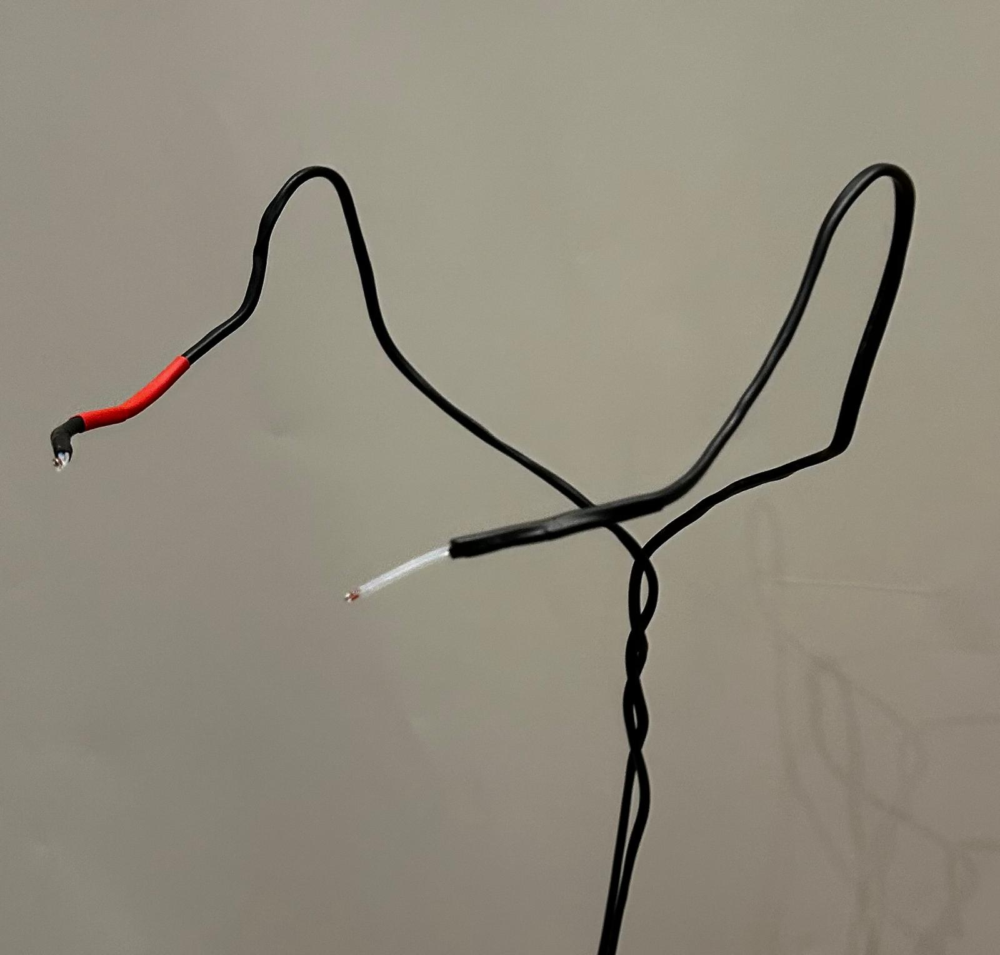
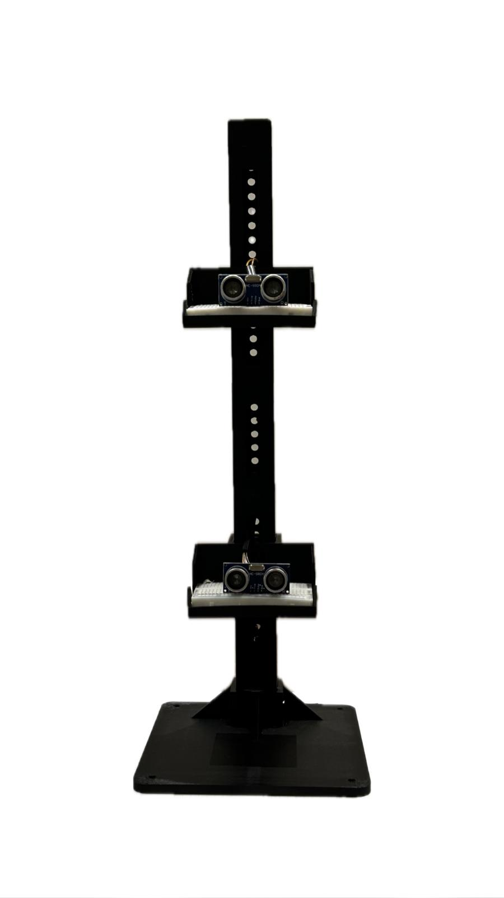
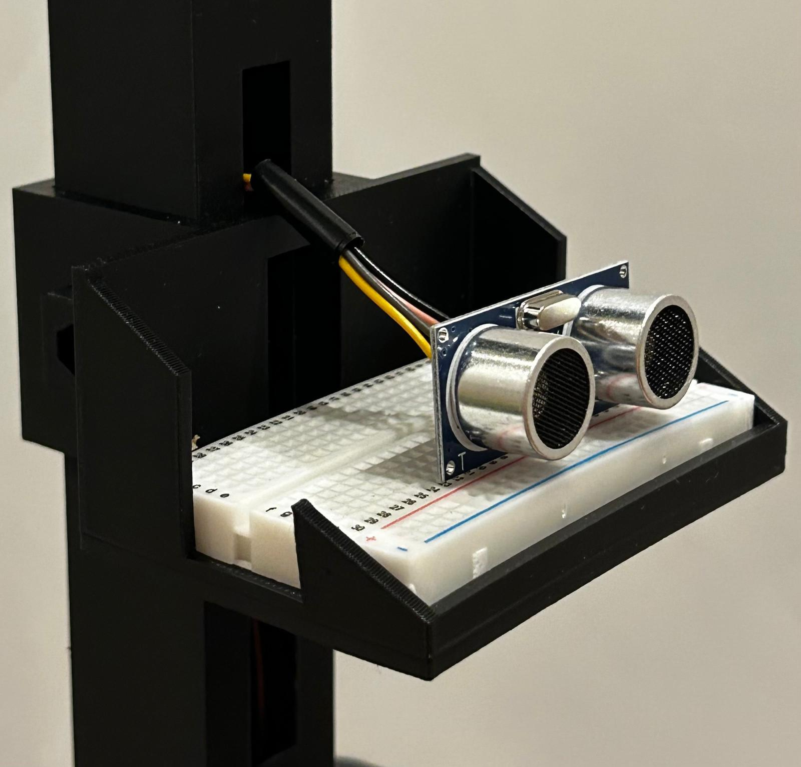
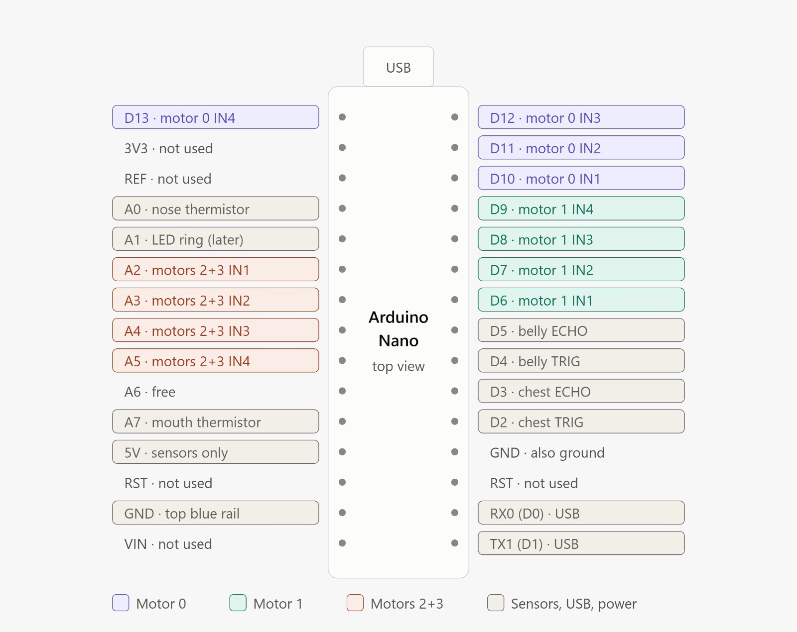

# Sensor setup

How the breathing sensors were built, mounted and connected to the Arduino Nano.

## 1. Thermistors (nose and mouth)

### Which thermistors
**2 × 100K NTC 3950 thermistors**, glass bead type, on a 1 m cable.

| Term | Meaning |
|---|---|
| 100K | 100,000 ohms at 25 °C |
| NTC | Resistance drops as they warm up, so breathing out makes the reading rise and breathing in makes it fall |
| 3950 | The beta value the code uses to convert readings into temperature |

One thermistor measures breath from the nose, the other from the mouth.

### How they were mounted
1. The thermistors already came with a long wire, so a **thick metal wire** that holds its shape was added alongside each thermistor cable.
2. **Heat shrink** was put around each thermistor cable together with the metal wire, making a stiffer, bendable mount for the sensor.
3. The wire was then **shaped around the face**, so the thermistors stay in place in front of the nose (about 1 cm below a nostril) and in front of the mouth (about 2 cm from the lips).

### How they connect
The thermistor wires go directly to a breadboard and then to the Arduino. Each thermistor is paired with a **100k Ω resistor** to form a voltage divider, because the Nano can only read voltage, not resistance.

| Thermistor | Nano pin |
|---|---|
| Nose | A0 |
| Mouth | A7 |

Each one: thermistor from 5V to the middle point, 100k resistor from the middle point to GND, middle point to the analog pin.

## 2. Ultrasonic sensors (chest and belly)

### Which sensors
**2 × HC SR04 ultrasonic distance sensors**: one pointed at the chest, one at the belly (diaphragm). They measure how far the body is, so they track the chest and belly moving in and out while breathing.

### How they were mounted
The sensors sit on an **adjustable stand** (3D printed) that can be moved to the correct height for each person who tests it, so the sensors always line up with that person's chest and belly.

### How they connect
Each ultrasonic sensor has **its own breadboard** on the stand. From there, its four wires (VCC for power, Trig, Echo and GND) go to the Arduino.

| Sensor | VCC | Trig | Echo | GND |
|---|---|---|---|---|
| Chest | 5V | D2 | D3 | GND |
| Belly | 5V | D4 | D5 | GND |

## 3. Arduino Nano pin map

## 4. Summary

| Sensor | What it measures | Mount | Nano pins |
|---|---|---|---|
| Nose thermistor | Air temperature of nose breath | Metal wire + heat shrink shaped around the face | A0 |
| Mouth thermistor | Air temperature of mouth breath | Metal wire + heat shrink shaped around the face | A7 |
| Chest ultrasonic | Chest movement | Own breadboard on adjustable stand | D2 (Trig), D3 (Echo) |
| Belly ultrasonic | Belly movement | Own breadboard on adjustable stand | D4 (Trig), D5 (Echo) |
